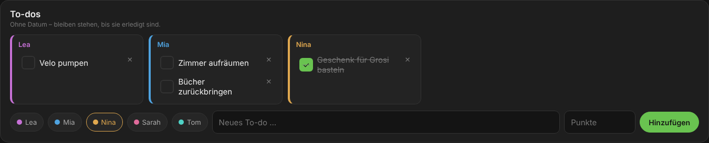
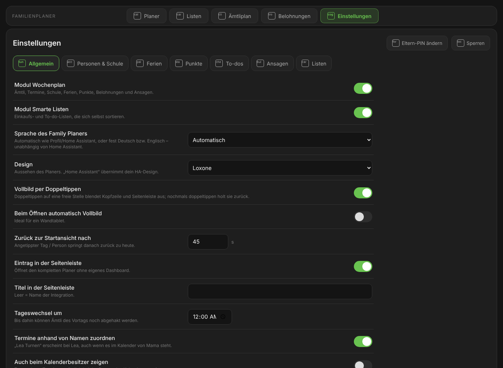

# Family Planer für Home Assistant

[](https://buymeacoffee.com/magibuilds)
[](https://github.com/magi1982/family-planer/actions/workflows/validate.yml)
[](https://github.com/magi1982/family-planer/actions/workflows/security.yml)
[](https://github.com/magi1982/family-planer/blob/main/LICENSE)

<a href="https://buymeacoffee.com/magibuilds"></a>

Der Familienplaner fürs Wandtablet: **Ämtli** mit Punkten und echten Belohnungen, **Termine und Stundenplan**
jeder Person auf einen Blick, **Ferien**, die Ämtli automatisch pausieren, **Ansagen** über Alexa sobald jemand
heimkommt – und **Einkaufs- und To-do-Listen, die sich selbst sortieren**. Alles wird in der Oberfläche
eingerichtet, **kein YAML**.

🇬🇧 [English](README.md) · 🇩🇪 **Deutsch**


---

## Inhalt

- [Überblick](#überblick)
- [Modul Wochenplan](#modul-wochenplan)
  - [Ämtli nach Wochentag](#ämtli-nach-wochentag)
  - [Besondere Ämtli nach Datum](#besondere-ämtli-nach-datum)
  - [Tageswechsel zur gewünschten Uhrzeit](#tageswechsel-zur-gewünschten-uhrzeit)
  - [Termine bei der richtigen Person](#termine-bei-der-richtigen-person)
  - [Schule & Stundenplan](#schule--stundenplan)
  - [Ferien pausieren Ämtli](#ferien-pausieren-ämtli)
  - [Zuverlässigkeit, Punkte, Level & Auszeichnungen](#zuverlässigkeit-punkte-level--auszeichnungen)
  - [Echte Belohnungen](#echte-belohnungen)
  - [Eltern-PIN](#eltern-pin)
  - [To-dos ohne Datum](#to-dos-ohne-datum)
  - [Ansagen bei Bewegung](#ansagen-bei-bewegung)
  - [Bilder: Avatare oder eigenes Foto](#bilder-avatare-oder-eigenes-foto)
- [Modul Smarte Listen](#modul-smarte-listen)
- [Designs](#designs)
- [Einstellungen im Planer](#einstellungen-im-planer)
- [Vollbild per Doppeltippen](#vollbild-per-doppeltippen)
- [Installation](#installation)
- [Einrichtung](#einrichtung)
- [Ansichten & Bedienung](#ansichten--bedienung)
- [Entitäten](#entitäten)
- [Dienste (Aktionen)](#dienste-aktionen)
- [Eigene Dashboards](#eigene-dashboards)
- [Sicherheit & Datenschutz](#sicherheit--datenschutz)
- [Umstieg vom Prototyp](#umstieg-vom-prototyp)
- [Entfernen](#entfernen)
- [Unterstützen](#unterstützen)

---

## Überblick

| | |
|---|---|
| **Module** | *Wochenplan* (Ämtli, Termine, Schule, Ferien, Punkte, Belohnungen, Ansagen) und *Smarte Listen* – einzeln ein- und ausschaltbar, weitere Module folgen |
| **Bedienung** | Eigener Eintrag in der Seitenleiste mit Navigation *Planer · Listen · Ämtliplan · Belohnungen · Einstellungen*; optional als Karten in eigenen Dashboards; Vollbild per Doppeltippen |
| **Einrichtung** | Direkt im Planer (*Einstellungen*, mit Eltern-PIN) oder über *Einstellungen → Geräte & Dienste* – kein YAML |
| **Sprachen** | Deutsch und Englisch – automatisch wie Home Assistant oder für den Planer fest auf Deutsch bzw. Englisch (z. B. Home Assistant auf Englisch, Planer auf Deutsch) |
| **Designs** | Home Assistant, Loxone, Apple Home, Google Home, Hell, Nord |
| **Abhängigkeiten** | Keine. Kalender, Listen, Lautsprecher und KI sind optional – es funktioniert jede passende Entität |
| **Voraussetzung** | Home Assistant 2026.3 oder neuer |

---

## Modul Wochenplan

### Ämtli nach Wochentag


- Pro Ämtli **mehrere Personen**, pro Person **eigene Wochentage** (z. B. Tisch decken: Lea Mo + Sa, Mia Di + So).
- **Rhythmus** pro Tag: jede Woche oder alle 2, 3, 4 … Wochen mit wählbarer Startwoche.
- **Zeit zum Erledigen**: „nur am Mittwoch“ oder „Mittwoch bis Samstag“. Erst nach Ablauf der Frist zählt ein Ämtli als „nicht gemacht“.
- **Punkte pro Ämtli** einstellbar (sonst gilt der Standardwert).
- **Wochenübersicht**: wie viele Ämtli jede Person pro Wochentag hat – so bleibt es fair.
- Änderungen gelten **sofort**; die Vergangenheit bleibt, wie sie war.

### Besondere Ämtli nach Datum


Für alles, was nicht wöchentlich ist:

| Art | Beispiel |
|---|---|
| **Intervall** | alle 6 Monate ab 15.03. – Luftfilter reinigen; alle 2 Wochen – Bettwäsche wechseln |
| **Monatlich** | am 1. jedes Monats; am letzten Tag; am 1. Samstag alle 3 Monate – Rauchmelder testen |
| **Jährlich** | 15.04. und 15.10. – Pneuwechsel |
| **Einmalig** | 21.11.2026 – Keller aufräumen |

- Mehrere Personen, wahlweise **abwechselnd** – ist jemand in den Ferien, übernimmt die nächste Person.
- Bis zu **60 Tage** Zeit zum Erledigen, eigene Punkte.
- Die Liste zeigt die **nächsten drei Termine** mit der zuständigen Person.

### Tageswechsel zur gewünschten Uhrzeit

Standard ist Mitternacht. Stellst du z. B. **03:00** ein, können die Ämtli des Vortags bis 3 Uhr nachts noch
abgehakt werden; danach zählen offene als „nicht gemacht“ und der neue Tag beginnt. Nach einem Neustart wartet der
Tageswechsel, bis die Kalender geladen sind – so wird niemand in den Ferien versehentlich als „nicht gemacht“ gezählt.

### Termine bei der richtigen Person

- Pro Person ein **Kalender** – jede `calendar.*`-Entität: Outlook/Microsoft 365 über *Remote Calendar* (ICS), Google, CalDAV, iCloud, Local Calendar …
- **Farbe des Kalenders = Farbe der Person**; jeder Termin trägt ein kleines Kalender-Abzeichen, damit man sieht, woher er stammt.
- **Zuordnung über Namen und Spitznamen** (abschaltbar): „Lea Turnen“ im Kalender von Mama erscheint bei Lea, „Tommy in Rust“ bei Tom.
- Optional: zugeordnete Termine **zusätzlich beim Kalenderbesitzer** anzeigen.
- Termine einzeilig: Titel, Zeit von–bis, Dauer, Kalender. Button zum **sofortigen Synchronisieren**.

### Schule & Stundenplan


Pro Kind (oder Person, z. B. Studium/Arbeit):

- **Schulkalender** mit den Lektionen (z. B. ICS aus WebUntis, Schulnetz, LehrerOffice) **oder feste Zeiten** pro Wochentag – bis zu **zwei Blöcke pro Tag** (Vormittag und Nachmittag, wenn das Kind über Mittag heimkommt).
- Optional der **Schul-/Arbeitsweg** in Minuten.
- **Ansicht „Alles“**: pro Block eine Zeile, z. B. `🎒 los 07:35 · zuhause 12:00 · 07:50–11:45` und `🎒 los 13:15 · zuhause 15:25 · 13:30–15:10`. Beim Schulkalender werden Blöcke automatisch getrennt, wenn zwischen zwei Lektionen genug Zeit für den Heimweg ist.
- **Nur wenn es zählt**: In der Ansicht „Alles“ erscheint ein Schulblock erst **1 Stunde vor dem Losgehen** und verschwindet **1 Stunde nach dem Heimkommen** – für jeden Block einzeln. Die Minuten sind einstellbar (*Schule nur rund um die Schulzeit zeigen*, 0 = immer anzeigen).
- **Ansicht „Stundenplan“**: nur Personen mit Stundenplan, jede Lektion mit Zeit und Ort (z. B. „Mathematik · Zimmer 12“).
- **Ansicht „Termine“** bleibt frei von Schule; **„Ämtli“** zeigt nur Ämtli.
- An Ferientagen wird keine Schule angezeigt.

### Ferien pausieren Ämtli

- Ein **ganztägiger** (oder mindestens 20 Stunden langer) Termin mit einem **Ferien-Wort** im Kalender einer Person pausiert ihre Ämtli – sie zählen **weder als erledigt noch als verpasst**, Zuverlässigkeit und Serie bleiben unberührt.
- Wortenden zählen: „Ferien“ findet „Skiferien“ und „Sommerferien“, aber nicht „Ferienplanung“.
- **Automatische Erkennung**: Beim ersten Sync eines Kalenders wird ein Jahr zurück und voraus gesucht, wie ihr Ferien nennt (z. B. *Ferien, Urlaub, OOO*). Die Wörter landen im Einstellungsfeld (änderbar) und du bekommst eine Mitteilung.
- Gilt wahlweise für die **Person des Kalenders bzw. die im Titel genannten Personen** oder für die **ganze Familie**.
- Wird ein Ferien-Termin während des Tages eingetragen, verschwinden offene Ämtli sofort (Kalender werden alle 30 Minuten gelesen).
- Im Planer erscheint 🌴 *Ferien*. Schulferien im Schulkalender pausieren bewusst **nicht** (wer daheim ist, macht Ämtli).

### Zuverlässigkeit, Punkte, Level & Auszeichnungen


- **Zuverlässigkeit** in Prozent (30 Tage), farbiges Band pro Person; Neue starten mit 100 % (*Startbonus*).
- **Faire Punkte** (Standard): Wer **alle** Ämtli des Tages erledigt, bekommt gleich viele Punkte (Standard 30) – egal ob 2 oder 6 Ämtli. Jedes erledigte Ämtli bringt sofort seinen Anteil; 3 von 6 erledigt = 50 % = 15 Punkte. Die Punkte im Ämtliplan wirken als Gewicht (ein schweres Ämtli mit 20 zählt doppelt so viel wie eines mit 10). Alternativ Modus *Pro Ämtli*: mehr Ämtli, mehr Punkte.
- **Punkte**: zusätzlich **Tagesbonus** für einen ganz erledigten Tag, **Serienbonus** für jede 7-Tage-Serie. Wird ein Ämtli wieder geöffnet, werden die Punkte zurückgebucht.
- **10 Level** von *Starter* über *Profi* und *Held* bis *Grossmeister* – mit Fortschrittsbalken. Eingelöste Punkte senken das Level nie.
- **Auszeichnungen**: 👑 Krone der Woche, 🏆 Pokal des Monats, 🐝 Fleissbiene, ⭐ Perfekte Woche, 🔥 Serie, 🚀 Startbonus – antippen zeigt, warum.
- **Verlauf** pro Person: Ämtli, Boni, Belohnungen.

### Echte Belohnungen

- Eltern legen Belohnungen **direkt in der Ansicht *Belohnungen*** mit *Bearbeiten* an und ändern sie (immer mit Eltern-PIN): z. B. *Glace = 30 Punkte*, *30 Min Gamen = 50*, *5 Fr. Taschengeld = 250*, *Kino = 400*.
- Pro Belohnung: Icon, **Kategorie**, **Freigabe nötig** ja/nein, **nur für** bestimmte Personen, **höchstens x-mal pro Woche**.
- **Kategorien statt Punkte ausrechnen**:

  | Kategorie | Punkte | Beispiel mit Standardwerten | Gegenwert (Standard 20) |
  |---|---|---|---|
  | Klein | ¼ von Gross | 283 | ca. 5 |
  | Mittel | ½ von Gross | 565 | ca. 10 |
  | **Gross** | so viel, wie man in **einem Monat** verdient, wenn **jeden Tag alle Ämtli** erledigt sind – inkl. Tages- und Serienbonus | 30 × (30 + 5) + 4 × 20 = **1130** | 20 |
  | Mega gross | 2 × Gross | 2260 | ca. 40 |
  | Riesig | 5 × Gross | 5650 | ca. 100 |

  Ändern sich die Punkte-Einstellungen, passen sich die Kosten automatisch an. Für Spezialfälle gibt es weiterhin *Eigene Punkte*. Der **Gegenwert einer grossen Belohnung** (z. B. 20 CHF) ist einstellbar und dient nur zur Orientierung.
- **Ansicht**: Ohne Auswahl zeigt die Seite **alle Belohnungen und alle offenen Anfragen**. Tippt man eine Person an, erscheinen nur ihre Belohnungen und Anfragen, und sie kann einlösen. Nochmals antippen hebt die Auswahl auf.
- Kinder lösen am Tablet ein; Punkte werden reserviert, bis die Eltern entscheiden.
- Eltern geben frei als **Admin** oder am Tablet mit **Eltern-PIN** (4–8 Ziffern). Mitteilung in Home Assistant und optional aufs Handy.
- **Punkte geben**: Bonus (oder Abzug) mit Grund, z. B. „Zimmer super aufgeräumt“ – mit denselben Grössen wie bei den To-dos (**Klein · Mittel · Gross**) oder einer eigenen Zahl.

### Eltern-PIN

- **Start-PIN `123456`** – sie muss **beim ersten Gebrauch geändert werden** (aktuelle PIN, neue PIN, wiederholen). Bis dahin lassen sich Belohnungen und Einstellungen nicht ändern, und Home Assistant zeigt einen Reparaturhinweis.
- Die PIN schützt: **Belohnungen anlegen/ändern**, die **Einstellungs-Seite**, Freigaben und Punkte geben (Admins dürfen Freigaben und Punkte auch ohne PIN).
- 4–8 Ziffern, nie wieder `123456`; nach 5 Fehlversuchen 5 Minuten gesperrt; gespeichert nur als PBKDF2-Hash.
- Nach einmaliger Eingabe bleibt der Planer **10 Minuten** entsperrt (verlängert sich beim Arbeiten, *Sperren* beendet es sofort). Die PIN selbst wird nie im Browser gespeichert.
- Ändern jederzeit: *Belohnungen → Bearbeiten → PIN ändern* oder *Einstellungen → Eltern-PIN ändern*. Vergessen? *Einstellungen → Geräte & Dienste → Family Planer → Konfigurieren → Punkte & Belohnungen → Eltern-PIN auf 123456 zurücksetzen* (nur Admins).

### To-dos ohne Datum



- Einfache To-dos für eine Person **ohne Ablaufdatum und ohne Wiederholung** – sie bleiben stehen, bis sie erledigt sind (z. B. *Zimmer aufräumen*, *Bücher zurückbringen*).
- Im **Planer** über den Knopf **„To-dos“** oben rechts (mit Anzahl offener To-dos) in einem eigenen Fenster; im **Ämtliplan** unten. Nach Person gruppiert; neues To-do mit Person + Text.
- **Abhaken mit Bestätigung** („Als erledigt markieren?“) – anders als Ämtli, die mit einem Tipp abgehakt werden. Abschaltbar.
- **Grösse statt Punkte**: *Ohne Punkte*, **Klein**, **Mittel** oder **Gross**. Gross = Punkte für einen ganzen Tag (Einstellung, Standard 30), Mittel = ⅔, Klein = ⅓ – immer auf ganze Punkte aufgerundet (30 → 10 / 20 / 30). Die Standard-Grösse ist einstellbar; eine andere Grösse beim Anlegen braucht die Eltern-PIN. To-dos zählen nicht zum fairen Tageswert.
- Erledigte To-dos bleiben eine einstellbare Anzahl Tage sichtbar und verschwinden dann.

### Ansagen bei Bewegung

- **Bewegungsmelder** wählen (Bewegung, Präsenz, Anwesenheit) und eine **Ansage** über
  - Alexa: Benachrichtigungs-Entität *Ankündigen* oder *Sprechen* (Integration *Alexa Devices*), oder
  - eine **TTS-Entität** (z. B. Google Translate, Piper) mit Lautsprechern.
- **Zeitfenster** (z. B. 15–20 Uhr) und **Pause** zwischen Ansagen.
- Ansage, wer noch was offen hat: *„Hallo! Noch offen: Lea: Tisch decken und Abfall leeren. Mia: Ratten füttern.“*
- Optional einmal pro Tag: *„Super gemacht! Alle Ämtli für heute sind erledigt.“*
- Die Ansage wird bei jeder Bewegung **frisch** erstellt – es wird nichts Veraltetes gespeichert.
- Testen per Dienst `family_planer.announce`.

**Warteschlange für einmalige Meldungen** – Meldungen, die nur einmal passieren, warten bis zur nächsten Bewegung
(innerhalb der eingestellten Ruhezeiten, z. B. 07–21 Uhr) und werden dann einmal gesagt, zusammen mit der Ämtli-Erinnerung:
- *„Mia, deine Belohnung ‹30 Min Gamen› wurde freigegeben. Viel Spass!“* – gültig bis zum Tageswechsel.
- *„Tom, in den nächsten 21 Tagen ist ‹Pneuwechsel› dran.“* – für besondere Ämtli; wird gestrichen, sobald das Ämtli erledigt ist.
- Eigene Meldungen aus Automationen mit `family_planer.queue_announcement` (Text, Gültigkeit, optional nur bestimmte Bewegungsmelder, Schlüssel zum Ersetzen/Löschen) und `family_planer.clear_announcement`.

```yaml
# Waschmaschine fertig -> Ansage, sobald jemand vorbeikommt (max. 3 Stunden)
action: family_planer.queue_announcement
data:
  message: Die Wäsche ist fertig, Nina ist dran mit Aufhängen.
  expires: 180
  key: waesche
  motion: [binary_sensor.gang_bewegung, binary_sensor.kueche_bewegung]
```

### Bilder: Avatare oder eigenes Foto


- Viele **bunte, gezeichnete Avatare**: Mädchen, Jungen, Frauen, Männer, Grosseltern, Verkleidete (Held, Astronaut, Pirat, Zauberer, Krone, Katze …).
- **Eigenes Foto hochladen**: wird im Browser quadratisch zugeschnitten und nur in deinem Home Assistant gespeichert.
- Farbe pro Person und Spitznamen direkt im Ämtliplan änderbar.

---

## Modul Smarte Listen


- **Beliebig viele Listen**, jede auf einer beliebigen To-do-Entität: Alexa, AnyList, Bring!, Todoist, Google Tasks, HA-Einkaufsliste … z. B. *Einkaufen Lebensmittel*, *Einkaufen Hornbach*, *Todos*.
- **Kategorien pro Liste, die sich selbst pflegen**:
  - neue Einträge werden **sofort** einsortiert – über eine eingebaute Wissensliste (Deutsch/Englisch, Lebensmittel, Drogerie, Haushalt, Tierbedarf, Werkzeug, Schrauben, Farbe, Garten, Elektro, Sanitär, Büro …),
  - **täglich** zur eingestellten Uhrzeit wird alles, was noch unter *Sonstiges* liegt, neu geordnet – optional mit einer **KI-Aufgabe** (OpenAI, Google, Ollama …),
  - **nie mehr als 5–20 Kategorien** (pro Liste wählbar); selten genutzte werden unter *Sonstiges* zusammengefasst.
- Eintrag **einmal verschieben – die Liste merkt es sich**.
- Kategorien auf der Karte **umbenennen, sortieren, hinzufügen, löschen**.
- Hinzufügen-Feld, abhaken, erledigte ein-/ausblenden und löschen. Mengenangaben („2x Milch“, „Mehl 1 kg“) werden beim Einordnen ignoriert.

---

## Designs

| Home Assistant | Loxone | Apple Home | Google Home | Hell | Nord |
|---|---|---|---|---|---|
| übernimmt dein HA-Design (Farben, Rundungen) | dunkel, Grün | schwarz, Orange | Material You | weiss, Blau | Nord-Farben |


Einstellbar unter *Konfigurieren → Design, Sprache & Seitenleiste*; Karten in eigenen Dashboards können es mit `theme:` überschreiben.

---

## Einstellungen im Planer



Alles, was die Home-Assistant-Dialoge bieten, auf einer übersichtlichen Seite – auch am Tablet: **Einstellungen** in der Navigation.
- Geschützt mit der **Eltern-PIN** (immer, auch für Admins).
- Register: *Allgemein* (Module, Sprache, Design, Vollbild, Seitenleiste, Tageswechsel …), *Personen & Schule* (Name, Farbe, Kalender, Spitznamen, Schulkalender, Blöcke pro Wochentag, Schulweg), *Ferien*, *Punkte*, *To-dos*, *Ansagen* (Entitäten aus Listen wählen), *Listen*.
- Jedes Feld mit kurzer Beschreibung; ungültige Eingaben werden mit klarer Meldung abgelehnt (z. B. Ansagen ohne Lautsprecher).
- Änderungen, die neue Zeitpläne brauchen (Tageswechsel, Module, Listen, Ansagen), laden die Integration automatisch neu; der Planer verbindet sich selbst wieder.
- Die Dialoge unter *Einstellungen → Geräte & Dienste → Family Planer → Konfigurieren* bleiben verfügbar.

## Vollbild per Doppeltippen

- **Doppeltippen auf eine freie Stelle** des Planers (Titelleiste, Ränder, Zwischenräume) → Kopfzeile und Seitenleiste von Home Assistant verschwinden, und der Browser schaltet – wo erlaubt – in echtes Vollbild. Nochmals doppeltippen beendet es.
- Tippen auf Ämtli, Knöpfe und Eingabefelder löst es nie aus – so wird nichts aus Versehen abgehakt.
- Optional: **beim Öffnen automatisch Vollbild** – ideal fürs Wandtablet. Beides unter *Einstellungen → Allgemein*.

---

## Installation

**Home Assistant 2026.11 und neuer (Marketplace):**
*Einstellungen → Marketplace* → „Family Planer“ suchen → installieren.
Solange die Integration noch nicht im Katalog ist: *Marketplace → Über Link hinzufügen* → `https://github.com/magi1982/family-planer`.

**Home Assistant 2026.3 – 2026.10 (HACS):**
HACS → ⋮ → *Benutzerdefinierte Repositories* → URL oben, Typ *Integration* → installieren → Home Assistant neu starten.

Danach: *Einstellungen → Geräte & Dienste → Integration hinzufügen → Family Planer*.

---

## Einrichtung

Beim Hinzufügen: **Name**, **Module**, **Familienmitglieder** (mit Komma getrennt) und optional die **erste Liste**.
Alles Weitere direkt im Planer unter **Einstellungen** (Eltern-PIN) oder unter *Einstellungen → Geräte & Dienste → Family Planer → Konfigurieren*. Jedes Feld hat eine
Beschreibung. Die Ämtli selbst werden direkt in der Ansicht **Ämtliplan** bearbeitet (auch am Tablet).

### Alle Einstellungen

**Module ein-/ausschalten**

| Einstellung | Standard | Bedeutung |
|---|---|---|
| Aktive Module | beide | *Wochenplan* und *Smarte Listen* einzeln ein-/ausschalten |

**Design, Sprache & Seitenleiste**

| Einstellung | Standard | Bedeutung |
|---|---|---|
| Sprache des Family Planers | Automatisch | *Automatisch*: wie im Profil bzw. Home Assistant · *Deutsch* oder *English*: gilt fest für Planer, Tablet-Ansichten, Ansagen, Benachrichtigungen und Level-Namen – unabhängig von der Sprache von Home Assistant. Die Einstellungsseiten selbst folgen der Sprache deines Profils. |
| Design | Loxone | Home Assistant, Loxone, Apple Home, Google Home, Hell, Nord |
| Eintrag in der Seitenleiste | ein | Öffnet den kompletten Planer ohne eigenes Dashboard |
| Titel in der Seitenleiste | Name | Text in der Seitenleiste |
| Zurück zur Startansicht nach | 45 s | Angetippter Tag / Person springt danach zurück zu heute |
| Vollbild per Doppeltippen | ein | Doppeltippen auf eine freie Stelle blendet Kopfzeile und Seitenleiste aus (echtes Vollbild, wo erlaubt) |
| Beim Öffnen automatisch Vollbild | aus | ideal fürs Wandtablet |

**Wochenplan → Person hinzufügen / bearbeiten / entfernen**

| Einstellung | Bedeutung |
|---|---|
| Name, Farbe | Farbe gilt auch für den Kalender der Person |
| Kalender | beliebige `calendar.*`-Entität |
| Spitznamen | Termine mit diesem Namen im Titel erscheinen bei der Person |

**Wochenplan → Schule & Stundenplan** (pro Person)

| Einstellung | Bedeutung |
|---|---|
| Schulkalender | Kalender mit den Lektionen (hat Vorrang vor festen Zeiten) |
| Mo–Sa Block 1 / Block 2 | feste Zeiten, zweiter Block z. B. für den Nachmittag |
| Schulweg berücksichtigen, Dauer | zeigt „los“ und „zuhause“ je Block |

**Wochenplan → Ferien & Abwesenheit**

| Einstellung | Standard | Bedeutung |
|---|---|---|
| Ämtli in den Ferien pausieren | ein | Ferien-Tage zählen weder als erledigt noch als verpasst |
| Wörter für Ferien | automatisch erkannt | z. B. *Ferien, Urlaub, OOO*; Wortenden zählen („Skiferien“) |
| Ferien gelten für | Person / Genannte | oder ganze Familie |
| Ganzer Tag ab | 20 h | Mindestdauer eines Termins mit Uhrzeit, um als Ferientag zu zählen |
| Kalender prüfen alle | 30 min | Wie oft auf neue Ferien geprüft wird |
| Neu durchsuchen | – | Kalender erneut nach Ferien-Wörtern durchsuchen |

**Wochenplan → Punkte & Belohnungen**

| Einstellung | Standard | Bedeutung |
|---|---|---|
| Belohnung: Titel, Icon, Kategorie | – | *Klein · Mittel · Gross · Mega gross · Riesig* oder eigene Punkte |
| Freigabe nötig / Nur für / Max. pro Woche | ja / alle / unbegrenzt | Regeln pro Belohnung |
| Punkte verteilen | Fair | *Fair*: ein ganzer Tag zählt, nicht die Anzahl Ämtli · *Pro Ämtli*: jedes Ämtli bringt seine Punkte |
| Punkte für einen ganzen Tag (fair) | 30 | Wird auf die Ämtli des Tages verteilt, jedes erledigte bringt sofort seinen Anteil |
| Punkte pro Ämtli | 10 | Modus *Pro Ämtli*: Punkte je Ämtli · Modus *Fair*: Standard-Gewicht; pro Ämtli im Ämtliplan änderbar |
| Tagesbonus | 5 | ganz erledigter Tag |
| Serienbonus | 20 | jede 7-Tage-Serie |
| Eltern-PIN | 123456 (muss geändert werden) | 4–8 Ziffern, nicht 123456; schützt Belohnungen, Einstellungen, Freigaben und Punkte; Sperre nach 5 Fehlversuchen. Vergessen: *Eltern-PIN auf 123456 zurücksetzen* |
| Anfragen melden an | – | zusätzliche Benachrichtigung (z. B. Handy-App) |
| Gegenwert einer grossen Belohnung | 20 | Geldwert zur Orientierung; Klein ¼, Mittel ½, Mega 2×, Riesig 5× |
| Währung | CHF | wird hinter den Beträgen angezeigt |

**Wochenplan → Ansagen bei Bewegung**

| Einstellung | Standard | Bedeutung |
|---|---|---|
| Ansagen einschalten | aus | |
| Bewegungsmelder | – | Bewegung, Präsenz, Anwesenheit |
| Ansage über / TTS + Lautsprecher | – | Alexa-Benachrichtigung („Ankündigen“/„Sprechen“) oder TTS |
| Von / Bis | 15:00 / 20:00 | Zeitfenster für Ämtli-Erinnerungen |
| Höchstens alle | 60 min | Pause zwischen Erinnerungen |
| Auch ansagen, wenn alles erledigt ist | ein | einmal pro Tag |
| Nur für | alle | Personen in der Erinnerung |
| Ämtli pro Person in der Ansage | 3 | weitere als „und 2 weitere“ |
| Warteschlange für einmalige Meldungen | ein | Meldungen warten auf Bewegung |
| Meldungen frühestens ab / spätestens bis | 07:00 / 21:00 | Ruhezeiten der Warteschlange |
| Freigegebene Belohnungen ansagen | ein | |
| Belohnungs-Meldung gültig für | 0 = bis Tageswechsel | Stunden |
| Besondere Ämtli ansagen | ein | entfällt, wenn erledigt |

**Wochenplan → Einstellungen**

| Einstellung | Standard | Bedeutung |
|---|---|---|
| Tageswechsel um | 00:00 | bis dahin können Ämtli des Vortags abgehakt werden |
| Termine anhand von Namen zuordnen | ein | „Lea Turnen“ erscheint bei Lea |
| Auch beim Kalenderbesitzer zeigen | aus | |
| Plan nur durch Admins änderbar | aus | Kinder können abhaken und Belohnungen anfragen |
| Zuverlässigkeit berechnen über | 30 Tage | |
| Heimweg über Mittag ab | 0 = automatisch | Pause in Minuten, ab der der Schultag in Blöcke geteilt wird |
| Schule nur rund um die Schulzeit zeigen | 60 min | Schulblock erscheint X Minuten vor dem Losgehen bis X Minuten nach dem Heimkommen (Ansicht „Alles“); 0 = immer |
| To-dos: Erledigen bestätigen | ein | Frage „Als erledigt markieren?“ vor dem Abhaken eines To-dos |
| To-dos: Standard-Grösse | Klein | *Ohne Punkte · Klein (⅓) · Mittel (⅔) · Gross (ganzer Tag)*; eine andere Grösse beim Anlegen braucht die Eltern-PIN |
| To-dos: erledigte anzeigen für | 1 Tag | 0 = bis zum nächsten Tageswechsel |

**Smarte Listen → Liste hinzufügen / bearbeiten / entfernen**

| Einstellung | Standard | Bedeutung |
|---|---|---|
| Name, To-do-Liste, Icon | – | jede `todo.*`-Entität |
| Höchstens so viele Kategorien | 10 | 5–20 |
| Kategorien automatisch pflegen | ein | sofort einsortieren und täglich optimieren |

**Smarte Listen → Einstellungen**

| Einstellung | Standard | Bedeutung |
|---|---|---|
| Tägliche Optimierung um | 03:00 | |
| KI-Aufgabe | – | optional, ordnet auch Unbekanntes ein |
| Ungenutzte Kategorie ersetzen nach | 30 Tage | macht Platz, wenn die Liste voll ist |

---

## Ansichten & Bedienung

Die Navigation ist auf allen Seiten oben in der Mitte an derselben Stelle.

**Planer** – die Woche im Querformat, optimiert fürs Tablet:
- Ansicht **„Alles“**: **heute gross, morgen mittel, alle anderen Tage ganz schmal** (vergangene Tage nur farbig mit Anzahl). In „Ämtli“ und „Termine“ sind die nächsten zwei Tage und das Wochenende mittel.
- Die Ämtli von heute stehen **zu zweit nebeneinander**, damit mehr auf den Querformat-Bildschirm passt.
- Ist nichts geplant, bleibt die Zelle **leer** (kein „frei“).
- **Pokale und Auszeichnungen** neben der Prozentzahl sind gross und gut sichtbar.
- Knopf **„To-dos“** oben rechts öffnet die To-dos in einem eigenen Fenster.
- Tag antippen zeigt ihn gross; Pfeile für andere Wochen, „Heute“ springt zurück.
- Filter **Alles · Ämtli · Termine · Stundenplan**.
- Ämtli direkt antippen zum Abhaken; Fristen („bis Sa“, „heute fällig“) sichtbar.
- Person antippen: Zuverlässigkeit, Serie, Auszeichnungen und wie man sie bekommt.

**Listen** – Tabs pro Liste, Hinzufügen-Feld, Kategorien als Kacheln, *Kategorien* und *Optimieren*.

**Ämtliplan** – Personen mit Bild & Farbe, Wochenübersicht, Ämtli nach Wochentag, darunter **Besondere Ämtli** und **To-dos**.

Im Planer: Knopf **„To-dos“** oben rechts → eigenes Fenster mit den To-dos jeder Person (antippen → bestätigen → erledigt).

**Belohnungen** – Punkte, Level, offene Freigaben, Belohnungen pro Person, Verlauf, *Punkte geben*, *Bearbeiten* (Belohnungen anlegen/ändern/löschen, PIN ändern – Eltern-PIN).

**Einstellungen** – alle Einstellungen mit Beschreibung, geschützt mit der Eltern-PIN (siehe oben).

---

## Entitäten

Pro Person (Gerät „Familienmitglied“):

| Entität | Inhalt |
|---|---|
| `todo.<person>_amtli` | Heutige Ämtli – abhaken auch per App, Sprachassistent oder Automation |
| `sensor.<person>_zuverlassigkeit` | Zuverlässigkeit in %, Attribute: offen/erledigt heute, Serie, Woche/Monat, Auszeichnungen |
| `sensor.<person>_punkte` | Punktestand, Attribute: verfügbar, gesamt verdient, Level, Level-Name, nächstes Level |

Die Entitäten-IDs richten sich nach der HA-Sprache und dem Personennamen.

---

## Dienste (Aktionen)

| Dienst | Zweck |
|---|---|
| `family_planer.rollover` | Tag sofort neu berechnen |
| `family_planer.set_item` | Ämtli per ID abhaken oder öffnen |
| `family_planer.add_points` | Punkte geben oder abziehen (Person, Punkte, Grund) |
| `family_planer.announce` | Ansage sofort auslösen (ohne Zeitfenster/Pause), gibt den Text zurück |
| `family_planer.queue_announcement` | Einmalige Meldung für die nächste Bewegung vormerken |
| `family_planer.clear_announcement` | Vorgemerkte Meldung per Schlüssel löschen |
| `family_planer.optimize_lists` | Alle Smarten Listen jetzt neu sortieren (optional mit KI) |
| `family_planer.import_legacy` | Daten aus dem To-do-Listen-Prototyp übernehmen |

Beispiel-Automation: Bonuspunkte, wenn die Waschmaschine ausgeräumt wurde.

```yaml
action: family_planer.add_points
data:
  person: Mia
  points: 15
  reason: Wäsche aufgehängt
```

---

## Eigene Dashboards

Nicht nötig – aber möglich. Die Karten werden automatisch geladen.

```yaml
type: vertical-stack
cards:
  - type: custom:family-planer-nav-card
    paths: { planer: planer, listen: einkauf, aemtliplan: aemtliplan, belohnungen: belohnungen }
  - type: custom:family-planer-card
    view: week        # week | plan | lists | rewards | settings
    theme: apple      # optional
    language: de      # optional, sonst Einstellung der Integration bzw. HA-Sprache
```

Für ein Vollbild-Tablet empfiehlt sich eine Panel-Ansicht pro Seite (Pfade wie oben) und z. B. *Kiosk Mode*.

---

## Sicherheit & Datenschutz

- Alles bleibt **lokal** in deinem Home Assistant; keine Cloud, kein Tracking. Externe Dienste nur, wenn du sie selbst wählst (Kalender, Listen, KI).
- Eingaben werden serverseitig geprüft (Farben, Bilder, Icons, Texte, Längen), Ausgaben im Browser maskiert.
- Eltern-PIN mit PBKDF2 gespeichert (Prüfung ausserhalb der Ereignisschleife), Start-PIN muss geändert werden, Sperre nach 5 Fehlversuchen; Entsperren über zufällige 10-Minuten-Tokens des Servers – die PIN bleibt nie im Browser. Optional dürfen nur Admins den Plan ändern.
- Fotos haben lange Zufallsnamen; Diagnose-Downloads enthalten keine Namen, Fotos oder Listeninhalte.
- Bei jedem Commit: **CodeQL**, **Bandit**, ESLint-Sicherheitsregeln, hassfest, HACS-Prüfung, Tests.

Details: [SECURITY.md](https://github.com/magi1982/family-planer/blob/main/SECURITY.md)

---

## Umstieg vom Prototyp

Wer den Familienplaner vorher mit To-do-Listen (`todo.amtli_plan`, `todo.amtli_heute`, `todo.amtli_verlauf`,
`todo.familienplaner_einstellungen`) betrieben hat, übernimmt alles mit:

```yaml
action: family_planer.import_legacy
data:
  plan: todo.amtli_plan
  today: todo.amtli_heute
  history: todo.amtli_verlauf
  settings: todo.familienplaner_einstellungen
```

---

## Entfernen

1. *Einstellungen → Geräte & Dienste → Family Planer → Löschen*.
2. Im Marketplace bzw. in HACS deinstallieren und Home Assistant neu starten.
3. Hochgeladene Fotos liegen in `config/family_planer/` und können gelöscht werden.

---

## Unterstützen

Wenn der Family Planer euren Familienalltag etwas leichter macht, freue ich mich über einen
[☕ Kaffee](https://www.buymeacoffee.com/magibuilds). Danke!

<a href="https://buymeacoffee.com/magibuilds"></a>

Fehler und Wünsche: [Issues](https://github.com/magi1982/family-planer/issues)
