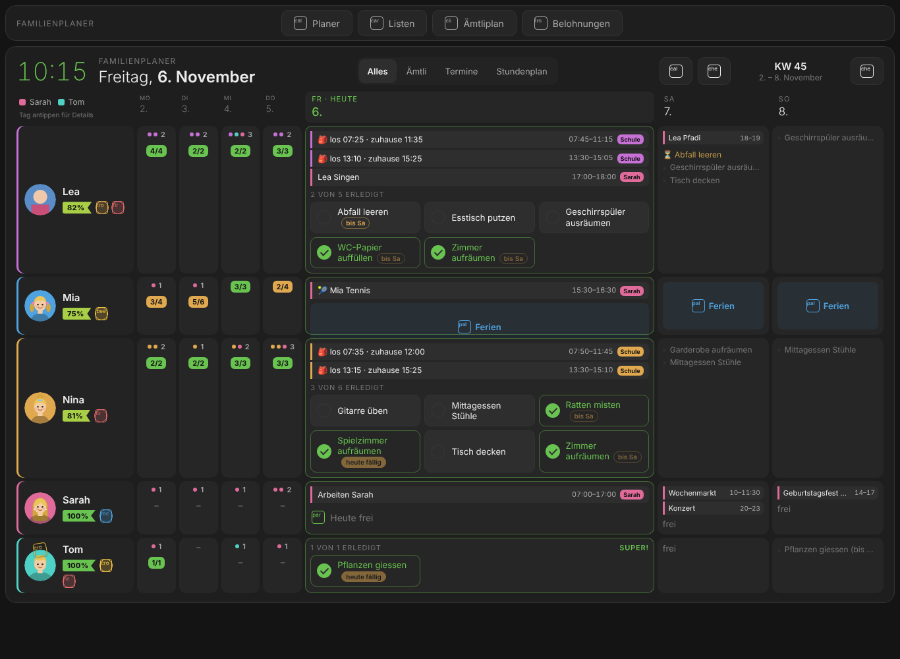
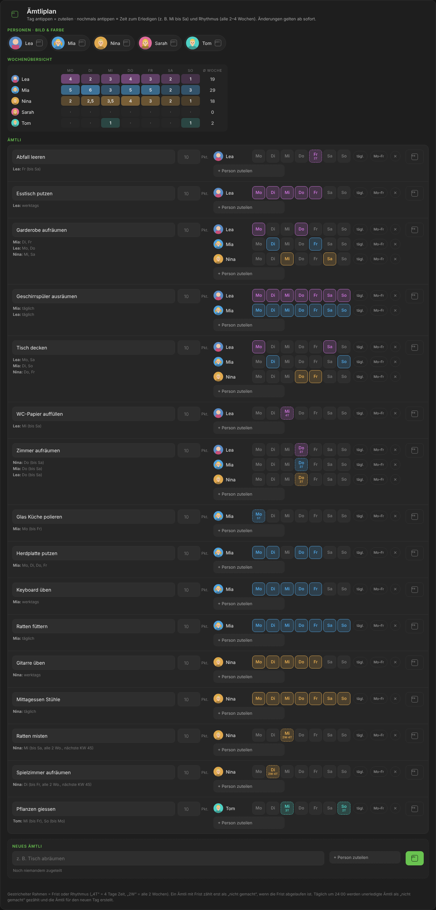
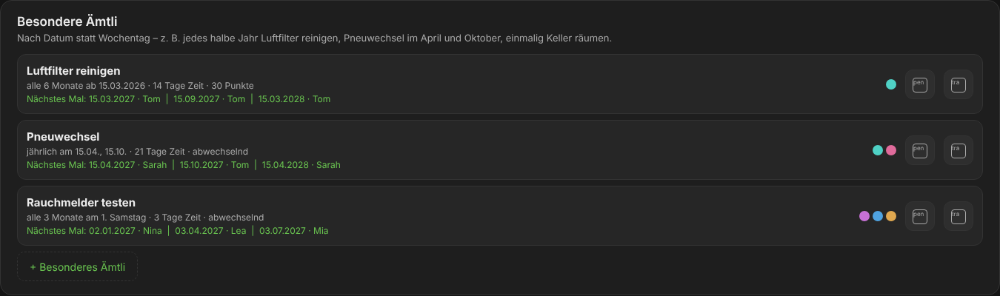
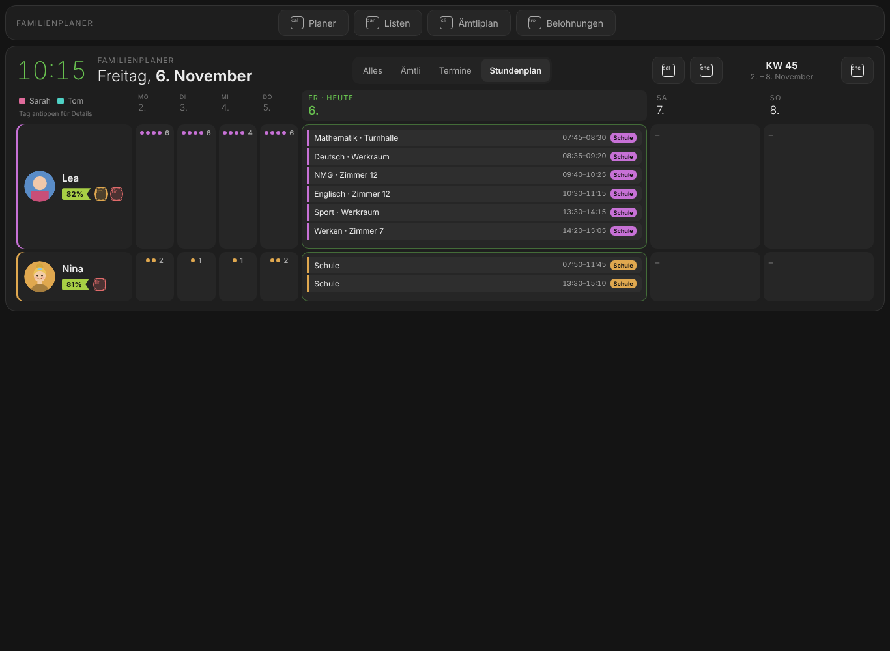
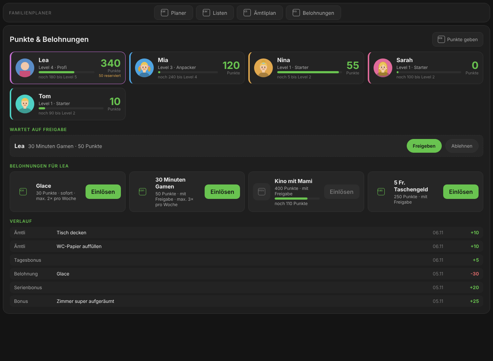
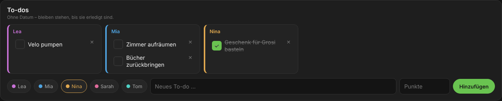
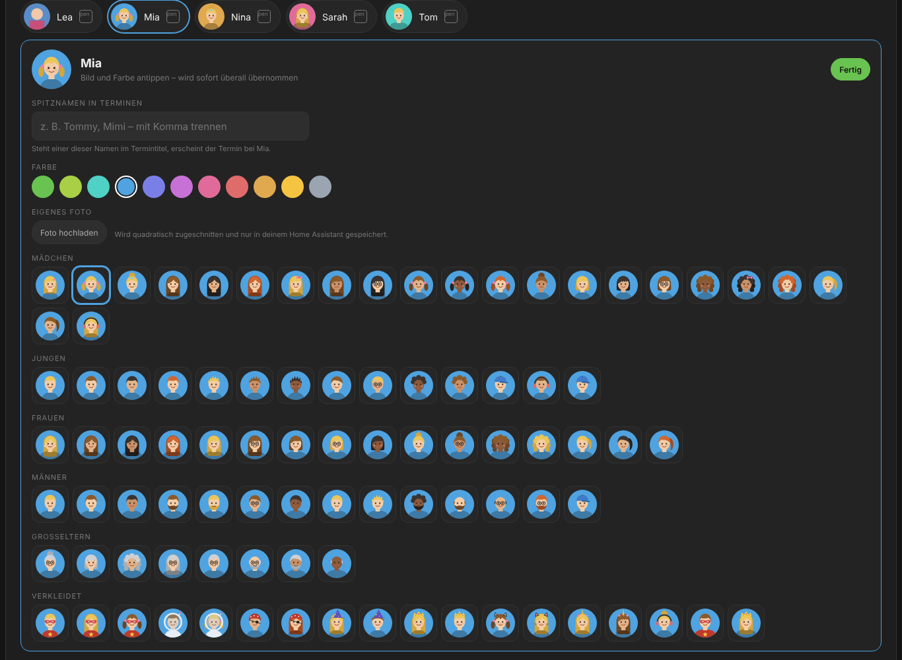
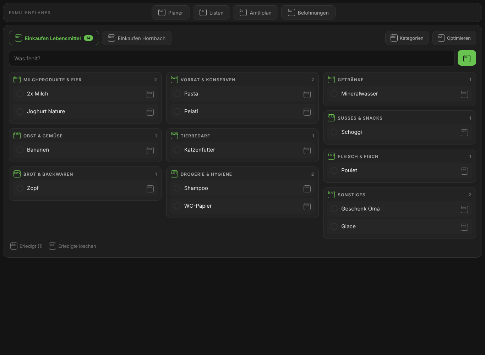
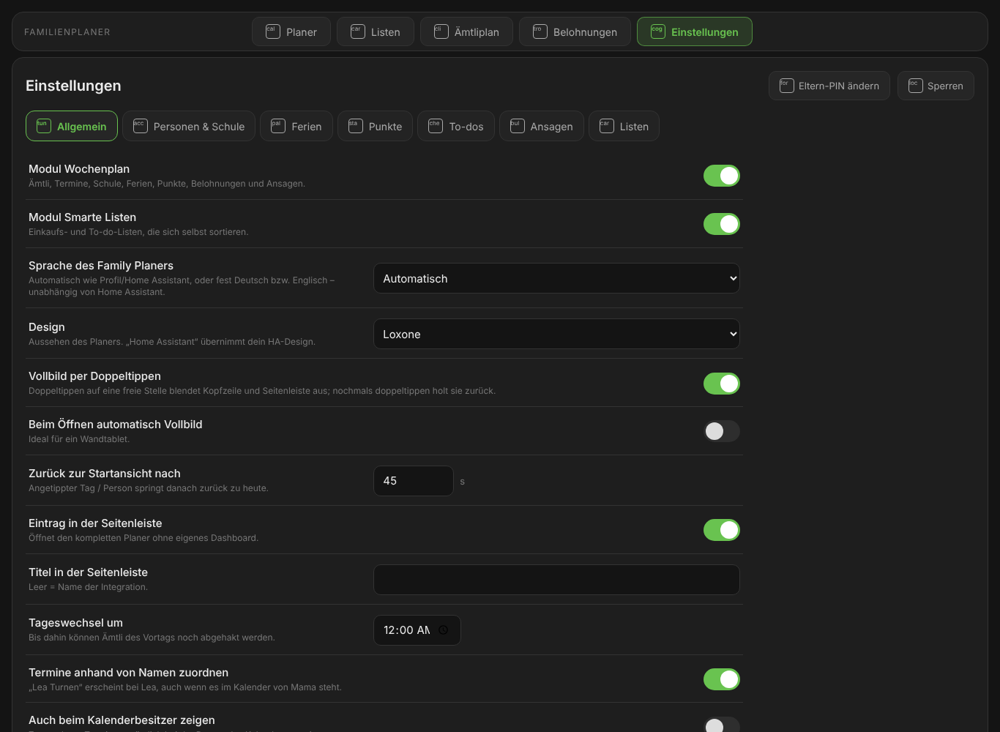

# Family Planer for Home Assistant

[](https://buymeacoffee.com/magibuilds)
[](https://github.com/magi1982/family-planer/actions/workflows/validate.yml)
[](https://github.com/magi1982/family-planer/actions/workflows/security.yml)
[](https://github.com/magi1982/family-planer/blob/main/LICENSE)

<a href="https://buymeacoffee.com/magibuilds"></a>

The family planner for your wall tablet: **chores** with points and real rewards, everyone's **events and school
timetable** at a glance, **holidays** that pause chores automatically, **spoken reminders** as soon as someone comes
home – and **shopping and to-do lists that sort themselves**. Everything is set up in the UI, **no YAML**.

🇬🇧 **English** · 🇩🇪 [Deutsch](README.de.md)



> The screenshots show the German interface. With Home Assistant set to English, everything appears in English.

---

## Contents

- [Overview](#overview)
- [Week plan module](#week-plan-module)
  - [Chores by weekday](#chores-by-weekday)
  - [Special chores by date](#special-chores-by-date)
  - [Day change at a time you choose](#day-change-at-a-time-you-choose)
  - [Events at the right person](#events-at-the-right-person)
  - [School & timetable](#school--timetable)
  - [Holidays pause chores](#holidays-pause-chores)
  - [Reliability, points, levels & awards](#reliability-points-levels--awards)
  - [Real rewards](#real-rewards)
  - [Parent PIN](#parent-pin)
  - [To-dos without a date](#to-dos-without-a-date)
  - [Announcements on motion](#announcements-on-motion)
  - [Pictures: avatars or your own photo](#pictures-avatars-or-your-own-photo)
- [Smart lists module](#smart-lists-module)
- [Designs](#designs)
- [Navigation](#navigation)
- [Settings in the planner](#settings-in-the-planner)
- [Fullscreen on double tap](#fullscreen-on-double-tap)
- [Installation](#installation)
- [Setup](#setup)
- [Views & usage](#views--usage)
- [Entities](#entities)
- [Services (actions)](#services-actions)
- [Custom dashboards](#custom-dashboards)
- [Security & privacy](#security--privacy)
- [Migrating from the prototype](#migrating-from-the-prototype)
- [Removal](#removal)
- [Support](#support)

---

## Overview

| | |
|---|---|
| **Modules** | *Week plan* (chores, events, school, holidays, points, rewards, announcements) and *Smart lists* – each can be switched on or off, more modules to come |
| **Usage** | Own sidebar entry with navigation *Planner · Lists · Chore plan · Rewards · Settings*; optionally as cards in your own dashboards; fullscreen on double tap |
| **Setup** | Directly in the planner (*Settings*, protected by the parent PIN) or via *Settings → Devices & services* – no YAML |
| **Languages** | English and German – automatically like Home Assistant, or fixed to German or English for the planner (e.g. Home Assistant in English, planner in German) |
| **Designs** | Standard (Home Assistant), Light, Dark, Rainbow, Space – each as Standard, Transparent or Glass |
| **Dependencies** | None. Calendars, lists, speakers and AI are optional – any matching entity works |
| **Requirement** | Home Assistant 2026.3 or newer |

---

## Week plan module

### Chores by weekday



- **Several persons** per chore, **own weekdays** per person (e.g. set the table: Lea Mon + Sat, Mia Tue + Sun).
- **Rhythm** per day: every week or every 2, 3, 4 … weeks with a selectable start week.
- **Time to complete**: "Wednesday only" or "Wednesday to Saturday". A chore only counts as "not done" once its deadline has passed.
- **Points per chore** can be set (otherwise the default applies).
- **Week overview**: how many chores each person has per weekday – keeps things fair.
- Changes apply **immediately**; the past stays as it was.

### Special chores by date



For everything that isn't weekly:

| Type | Example |
|---|---|
| **Interval** | every 6 months from 15 March – clean the air filter; every 2 weeks – change the bed linen |
| **Monthly** | on the 1st of every month; on the last day; on the 1st Saturday every 3 months – test the smoke detectors |
| **Yearly** | 15 April and 15 October – change tyres |
| **Once** | 21 November 2026 – tidy up the cellar |

- Several persons, optionally **taking turns** – if someone is on holiday, the next person takes over.
- Up to **60 days** to complete, own points.
- The list shows the **next three dates** with the responsible person.

### Day change at a time you choose

The default is midnight. If you set e.g. **03:00**, the previous day's chores can still be ticked off until 3 am;
after that, open ones count as "not done" and the new day starts. After a restart, the day change waits until the
calendars have loaded – so nobody on holiday is accidentally counted as "not done".

### Events at the right person

- One **calendar** per person – any `calendar.*` entity: Outlook/Microsoft 365 via *Remote Calendar* (ICS), Google, CalDAV, iCloud, Local Calendar …
- **Calendar colour = person colour**; every event carries a small calendar badge so you can see where it comes from.
- **Assignment by names and nicknames** (can be switched off): "Lea gymnastics" in mum's calendar appears at Lea, "Tommy in Rust" at Tom.
- Optional: show assigned events **also at the calendar owner**.
- Events on one line: title, time from–to, duration, calendar. Button to **sync immediately**.

### School & timetable



Per child (or person, e.g. university/work):

- **School calendar** with the lessons (e.g. ICS from WebUntis or other school systems) **or fixed times** per weekday – up to **two blocks per day** (morning and afternoon, when the child comes home for lunch).
- Optional **travel time** to school/work in minutes.
- **"All" view**: one line per block, e.g. `🎒 leave 07:35 · home 12:00 · 07:50–11:45` and `🎒 leave 13:15 · home 15:25 · 13:30–15:10`. With a school calendar, blocks are split automatically when there is enough time between two lessons to go home.
- **Only when it matters**: in the "All" view a school block appears **1 hour before leaving** and disappears **1 hour after getting home** – for each block separately. The minutes are adjustable (*Show school only around school time*, 0 = always show).
- **"Timetable" view**: only persons with a timetable, every lesson with time and room (e.g. "Maths · Room 12").
- The **"Events"** view stays free of school; **"Chores"** shows chores only.
- No school is shown on holidays.

### Holidays pause chores

- An **all-day** (or at least 20-hour) event with a **holiday word** in a person's calendar pauses their chores – they count **neither as done nor as missed**; reliability and streak are not affected.
- Word endings count: "holiday" finds "ski holiday" and "summer holiday" – in German "Ferien" finds "Skiferien" but not "Ferienplanung".
- **Automatic detection**: on the first sync of a calendar, one year back and ahead is searched for how you name holidays (e.g. *Vacation, Holiday, OOO*). The words end up in the settings field (editable) and you get a notification.
- Applies either to the **calendar's person or the persons named in the title**, or to the **whole family**.
- If a holiday event is added during the day, open chores disappear immediately (calendars are read every 30 minutes).
- **Holiday check**: from **two weeks before** a holiday, the 🌴 button in the navigation asks: **Away – pause chores** or **Here – chores go on**, and for whom: the **whole family** or single persons. Past holidays are ignored.
- **Long events without a holiday word** (longer than the set number of hours, e.g. a camp or a trip) appear below as **Optional**; without a decision they pause nothing.
- Once decided, an entry disappears from the popup. Under *Settings → Holidays* it stays for **4 weeks** and can still be changed or reset.
- The planner shows 🌴 *Holiday*. School holidays in the school calendar deliberately do **not** pause chores (whoever is at home does chores).

### Reliability, points, levels & awards



- **Reliability** in percent (30 days), coloured band per person.
- **Fair points** (default): whoever finishes **all** of their chores of the day gets the same number of points (default 30) – whether they have 2 or 6 chores. Every finished chore immediately earns its share; 3 of 6 done = 50 % = 15 points. The points in the chore plan act as weights (a heavy chore with 20 counts twice as much as one with 10). Alternatively *per chore* mode: more chores, more points.
- **Bonuses**: additionally a **day bonus** for a fully completed day and a **streak bonus** for every 7-day streak. If a chore is reopened, its points are booked back.
- **10 levels** from *Starter* via *Pro* and *Hero* to *Grandmaster* – with progress bar. Redeemed points never lower the level.
- **Awards and trophies** – each one has a period, so nobody collects three trophies a day:

  | Award | Won | Frame / points (default) |
  |---|---|---|
  | 🏆 Trophy of the month | best rate of the previous month, on the 1st | **platinum** frame · large |
  | 👑 Crown of the week | best rate of the previous week, on Monday | **gold** frame · medium |
  | ⭐ Perfect week | every chore of a whole week done | **silver** frame · medium |
  | 🐝 Busy bee | most done in a week | **bronze** frame · small |
  | 🛡️ Weekend hero | Saturday and Sunday everything done | small |
  | 📈 Climber | at least 15 points better than the week before | medium |
  | 🌅 Early bird | on 4 days of the week everything done before 12:00 (adjustable) | small |
  | 💎 Diamond streak | 30 days in a row everything done | giant |
  | 🏅 Milestones | 100, 500 and 1000 chores in total | medium |
  | 👪 Family teamwork | the whole family finished everything on one day | small |
  | 🔥 Streak | days in a row (changes daily, no points) | – |

- The **best award sets a metallic frame** around the picture (platinum, gold, silver, bronze) with a gentle shine; the crown sits straight above the head.
- **Points per award**: once per win, and again when it is won anew. Sizes: small = ⅓, medium = ⅔, large = 1×, giant = 2× the points for a full day. Every award can be switched off or resized under *Settings → Points*.
- **Confetti for everyone** (adults too): small confetti with the name when somebody has done all of their chores for the day; medium or large confetti in the trophy colour for trophies. At most one big confetti per person and day; daily changing awards (streak, busy bee, early bird) get none. Can be switched off; respects *reduce motion*.
- **Fair for percentages and awards, too**: in *Fair* mode, reliability, crown of the week, trophy of the month and busy bee count **every day the same** – no matter if 2 or 6 chores. The rate is the average of the daily rates; the busy bee has the most complete chore days. In *Per chore* mode single chores count as before.
- **History** per person: chores, bonuses, rewards.

### Real rewards

- Parents create rewards **directly in the *Rewards* view** with **"+ Reward"** on a person's tile, and change or delete them by tapping the pencil next to a reward (always with the parent PIN): e.g. *ice cream = 30 points*, *30 min gaming = 50*, *5 CHF pocket money = 250*, *cinema = 400*. With nobody chosen in the dialog the reward is for everyone.
- Per reward: icon, **category**, **approval required** yes/no, **only for** certain persons, **at most x times per week**.
- **Categories instead of doing the maths**:

  | Category | Points | Example with defaults | Value (default 20) |
  |---|---|---|---|
  | Small | ¼ of large | 283 | approx. 5 |
  | Medium | ½ of large | 565 | approx. 10 |
  | **Large** | what you earn in **one month** with **every chore done every day** – incl. day and streak bonus | 30 × (30 + 5) + 4 × 20 = **1130** | 20 |
  | Mega | 2 × large | 2260 | approx. 40 |
  | Giant | 5 × large | 5650 | approx. 100 |

  When the point settings change, the costs follow automatically. *Own points* is still available for special cases. The **value of a large reward** (e.g. 20 CHF) is adjustable and only meant as a guide.
- **View**: at the top **still to win** – every trophy nobody holds right now, with how to win it, when it is awarded, its points and who is ahead.
- Below, a **tile per person** like in the planner: picture with frame, medals, points and level, **what is running** (requests waiting for approval, rewards made for this person or the next goal with progress and *"in about 6 days"*) and a **"+ Reward"** button that creates a reward for exactly this person (parent PIN).
- Tapping a person shows their awards, their rewards and history; with nobody selected you see all rewards with the persons they are for.
- **Forecast** in the reward dialog: how many days the family average needs for the chosen cost, and how long each person needs at their current pace.
- Children redeem on the tablet; points are reserved until the parents decide.
- Parents approve as **admin** or on the tablet with a **parent PIN** (4–8 digits). Notification in Home Assistant and optionally on the phone.
- **Extra points** are given with a to-do of the right size (Small · Medium · Large); the action `family_planer.add_points` stays available for automations.

### Parent PIN

- **Start PIN `123456`** – it must be **changed on first use** (current PIN, new PIN, repeat). Until then, rewards and settings cannot be changed, and Home Assistant shows a repair notice.
- **What needs the PIN**: every change – chores and the chore plan, special chores, to-dos (add/delete), persons (name, colour, calendar, role, order), lists, rewards, the design, holiday decisions and the settings page. Approving rewards and giving points as well (admins may do these two without it).
- **What does not**: ticking off chores and to-dos, redeeming rewards, and **changing a picture** (figure, hair, skin tone, extras, costume) – anyone may change any picture.
- 4–8 digits, never `123456` again; locked for 5 minutes after 5 wrong attempts; stored only as a PBKDF2 hash.
- After entering it once, the planner stays unlocked for **10 minutes** (refreshed while you work, *Lock* ends it immediately). The PIN itself is never stored in the browser.
- Change it any time: *Settings → Parent PIN → Change parent PIN*. Forgotten? *Settings → Devices & services → Family Planer → Configure → Points & rewards → Reset parent PIN to 123456* (admins only).

### To-dos without a date



- Simple to-dos for a person **without due date or repetition** – they stay until they are done (e.g. *tidy up the room*, *return library books*).
- In the **planner** via the **"To-dos"** button at the top right (with the number of open to-dos) in a window of their own; in the **chore plan** at the bottom. Grouped by person; add one with person + text.
- **Ticking off asks for confirmation** ("Mark as done?") – unlike chores, which are ticked with one tap. Can be switched off.
- **Size instead of points**: *No points*, **Small**, **Medium** or **Large**. Large = points for a full day (setting, default 30), medium = ⅔, small = ⅓ – always rounded up to whole points (30 → 10 / 20 / 30). The default size is adjustable; another size when adding needs the parent PIN. To-dos do not count towards the fair day value.
- Finished to-dos stay visible for a configurable number of days, then disappear.

### Announcements on motion

- Choose **motion sensors** (motion, presence, occupancy) and an **announcement** via
  - Alexa: notify entity *Announce* or *Speak* (*Alexa Devices* integration), or
  - a **TTS entity** (e.g. Google Translate, Piper) with speakers.
- **Time window** (e.g. 15:00–20:00) and **pause** between announcements.
- Announces who still has something open: *"Hello! Still open: Lea: set the table and empty the bin. Mia: feed the rats."*
- Optionally once a day: *"Well done! All chores for today are finished."*
- The announcement is built **fresh** on every motion – nothing outdated is stored.
- Test with the `family_planer.announce` service.

**Queue for one-off messages** – messages that only happen once wait for the next motion (within the configured quiet
hours, e.g. 07:00–21:00) and are then spoken once, together with the chore reminder:
- *"Mia, your reward '30 min gaming' has been approved. Have fun!"* – valid until the day change.
- *"Tom, 'Tyre change' is due within the next 21 days."* – for special chores; dropped as soon as the chore is done.
- Your own messages from automations with `family_planer.queue_announcement` (text, validity, optionally only certain motion sensors, key for replacing/deleting) and `family_planer.clear_announcement`.

```yaml
# Washing machine finished -> announce as soon as someone walks by (max. 3 hours)
action: family_planer.queue_announcement
data:
  message: The laundry is done, Nina's turn to hang it up.
  expires: 180
  key: laundry
  motion: [binary_sensor.hallway_motion, binary_sensor.kitchen_motion]
```

### Pictures: avatars or your own photo



- **Avatar builder** under *Settings* – **without the PIN**, anyone may change any picture:
  1. **Skin tone** (9) and **hair colour** (12, incl. pink, blue, purple, green)
  2. **Person**: girl, boy, woman, man, grandma, grandpa
  3. **Hair**, chosen separately: 18 styles – short, side parting, spiky, messy, undercut, mohawk, short curls, bald, long, long with fringe, pigtails, ponytail, bun, space buns, bob, long curls, afro, dreadlocks
  4. Tabs with lots of extras: **Head** (cap, bobble hat, crown, flower crown, cat / bunny / bear ears, unicorn, party hat, headphones, headband, bow), **Face** (glasses, sunglasses, freckles, glitter, plaster, tiger or butterfly face paint, beard, moustache), **Clothes** (T-shirt colour, motif, scarf, bow tie, necklace), **Buddy** (cat, dog, bunny, parrot, lizard, monkey, mini dragon, penguin, fox, robot, owl, balloon, football, guitar, magic wand), **Background** (8 patterns over the person's colour, which always stays)
  5. **Costumes** as a layer over the person: astronaut, Mars suit, our own heroes *Star Power*, *Sparkwing*, *Moon Fairy*, *Turbo* and *Shooting Star*, ninja, knight, pirate, wizard, princess, prince, dino, firefighter – background and buddy stay
- 🎲 **Random** for a surprise. Parts that would clash (e.g. a cap under a helmet) are left out automatically; an automated test draws over 30 000 combinations.
- Plus many ready-made avatars: girls, boys, women, men, grandparents, dressed up.
- **Upload your own photo**: cropped to a square in the browser and stored only in your Home Assistant.
- Colour, nicknames and everything else of a person: *Settings → People* (parent PIN).

---

## Smart lists module



- **Any number of lists**, each on any to-do entity: Alexa, AnyList, Bring!, Todoist, Google Tasks, HA shopping list … e.g. *Groceries*, *DIY store*, *To-dos*.
- **Self-maintaining categories per list**:
  - new items are sorted **immediately** – using a built-in knowledge list (English/German: groceries, drugstore, household, pet supplies, tools, screws, paint, garden, electrical, plumbing, office …),
  - **daily** at the configured time, everything still under *Other* is reorganised – optionally with an **AI task** (OpenAI, Google, Ollama …),
  - **never more than 5–20 categories** (selectable per list); rarely used ones are merged into *Other*.
- **Move an item once – the list remembers it**.
- **Rename, sort, add and delete** categories on the card.
- Add field, tick off, show/hide and delete completed items. Quantities ("2x milk", "flour 1 kg") are ignored when sorting.

---

## Designs

| Standard | Light | Dark | Rainbow | Space |
|---|---|---|---|---|
| follows your Home Assistant theme | white, blue | dark, green | dark with a rainbow band and colourful glow | deep blue with stars and nebula |

Each design comes in three **styles**: *Standard*, *Transparent* and *Glass* (frosted surfaces over the design's background). Older designs (Loxone, Apple, Google, Nord) are switched to *Dark* automatically.

**Switch the design like in an app**: a small colour swatch at the top right of the navigation shows the current design. Tapping it opens a picker with a **mini preview** of every design and the style; one tap switches at once, on every device. Changing it needs the parent PIN.

- Still available under *Settings → General* and *Configure → Design, language & sidebar*. Cards in your own dashboards can override it with `theme:` / `style:`. `theme_picker: false` on the navigation card hides the picker.
- Your own dashboard can use the design's background with `background: var(--fp-page)` on the view.

## Navigation

- One row: **time and date** on the left (or the planner's title), the pages in the middle, on the right the **holiday check** 🌴 and the design picker.
- **Holiday check** 🌴: a badge shows how many holidays and long events of the next two weeks are undecided (details under *Holidays pause chores*). Parent PIN.
- **Order and visible buttons** under *Settings → General*. If a button points to a view your dashboard does not have, it is shown dashed with a hint instead of opening an empty page.
- **Today**: a red now line separates past and coming events, the next event shows *in 25 min*; ticking off a chore plays a short check animation.
- **Phone**: the planner shows only today, with ‹ › arrows and swipe for the other days; it returns to today after the idle time.

## Settings in the planner



Everything that the Home Assistant dialogs offer, in one clear page – also on the tablet: **Settings** in the navigation.
- Protected by the **parent PIN** (always, also for admins).
- **Without the PIN** the page shows only the **pictures** (avatar builder and photo upload). **"Parent PIN"** at the top right opens every tab: *Pictures*, *General* (modules, language, design and style, navigation order, fullscreen, sidebar, day change, …), *People* (order, role child/adult, colour, calendar, nicknames, school calendar, blocks per weekday, travel time), ***Chores*** (the complete chore plan – **"+ Special chore"** and **"+ To-do"** open a form in a popup; the separate chore-plan page is hidden by default), *Points* (incl. every award with on/off and size, early-bird time, confetti), *To-dos*, *Lists*, *Holidays* (holiday check), *Announcements*, ***Status*** (last successful sync and last error for every calendar, list and the day change; sources silent for 30 days disappear).
- Every field with a short description; invalid input is refused with a clear message (e.g. announcements without speaker).
- Changes that need new timers (day change, modules, lists, announcements) reload the integration automatically; the planner reconnects by itself.
- The dialogs under *Settings → Devices & services → Family Planer → Configure* remain available.

## Fullscreen on double tap

- **Double-tap an empty spot** of the planner (title bar, margins, gaps) → Home Assistant's header and sidebar disappear, and the browser switches to real fullscreen where allowed. Double-tap again to leave.
- Taps on chores, buttons and input fields never trigger it, so nothing is ticked off by accident.
- Optional: **fullscreen automatically when opened** – ideal for a wall tablet. Both under *Settings → General*.

---

## Installation

**Home Assistant 2026.11 and newer (Marketplace):**
*Settings → Marketplace* → search for "Family Planer" → install.
As long as the integration is not yet in the catalogue: *Marketplace → Add from link* → `https://github.com/magi1982/family-planer`.

**Home Assistant 2026.3 – 2026.10 (HACS):**
HACS → ⋮ → *Custom repositories* → URL above, type *Integration* → install → restart Home Assistant.

Then: *Settings → Devices & services → Add integration → Family Planer*.

---

## Setup

When adding: **name**, **modules**, **family members** (comma separated) and optionally the **first list**.
Everything else directly in the planner under **Settings** (parent PIN) or under *Settings → Devices & services → Family Planer → Configure*. Every field has a
description. The chores themselves are edited directly in the **Chore plan** view (also on the tablet).

### All settings

**Switch modules on/off**

| Setting | Default | Meaning |
|---|---|---|
| Active modules | both | switch *Week plan* and *Smart lists* on or off individually |

**Design, language & sidebar**

| Setting | Default | Meaning |
|---|---|---|
| Family Planer language | Automatic | *Automatic*: like your profile / Home Assistant · *Deutsch* or *English*: fixed for planner, tablet views, announcements, notifications and level names, independent of the Home Assistant language. The settings pages themselves follow your profile language. |
| Design | Standard | Standard (Home Assistant), Light, Dark, Rainbow, Space |
| Style | Standard | Standard, Transparent, Glass |
| Sidebar entry | on | opens the complete planner without a dashboard of your own |
| Sidebar title | name | text in the sidebar |
| Return to the start view after | 45 s | a tapped day / person jumps back to today afterwards |
| Fullscreen on double tap | on | double-tap an empty spot hides header and sidebar (real fullscreen where allowed) |
| Fullscreen automatically when opened | off | ideal for a wall tablet |

**Week plan → Add / edit / remove person**

| Setting | Meaning |
|---|---|
| Name, colour | the colour is also used for the person's calendar |
| Calendar | any `calendar.*` entity |
| Nicknames in events | events with this name in the title appear at the person |

**Week plan → School & timetable** (per person)

| Setting | Meaning |
|---|---|
| School calendar / timetable | calendar with the lessons (takes priority over fixed times) |
| Mon–Sat block 1 / block 2 | fixed times, second block e.g. for the afternoon |
| Consider travel time, duration | shows "leave" and "home" per block |

**Week plan → Holidays & absence**

| Setting | Default | Meaning |
|---|---|---|
| Pause chores during holidays | on | holiday days count neither as done nor as missed |
| Words for holidays | detected automatically | e.g. *Vacation, Holiday, OOO*; word endings count ("ski holiday") |
| Holidays apply to | person / persons named | or the whole family |
| Whole day from | 20 h | minimum duration of a timed event to count as a holiday |
| Check calendars every | 30 min | how often new holidays are checked |
| Search again | – | search the calendars for holiday words again |

**Week plan → Points & rewards**

| Setting | Default | Meaning |
|---|---|---|
| Reward: title, icon, category | – | *Small · Medium · Large · Mega · Giant* or own points |
| Needs parent approval / Only for / Max per week | yes / everyone / unlimited | rules per reward |
| How points are given | Fair | *Fair*: a full day counts, not the number of chores · *Per chore*: each chore earns its points |
| Points for a full day (fair) | 30 | split across the day's chores, each finished chore earns its share immediately |
| Points per chore | 10 | *Per chore* mode: points per chore · *Fair* mode: default weight; can be changed per chore in the chore plan |
| Bonus for a fully completed day | 5 | |
| Bonus for every 7-day streak | 20 | |
| Parent PIN | 123456 (must be changed) | 4–8 digits, not 123456; protects rewards, settings, approvals and points; locked after 5 wrong attempts. *Reset parent PIN to 123456* if forgotten |
| Also send requests to | – | additional notification (e.g. mobile app) |
| Value of a large reward | 20 | money value as a guide; small ¼, medium ½, mega 2×, giant 5× |
| Currency | CHF | shown after the amounts |

**Week plan → Announcements on motion**

| Setting | Default | Meaning |
|---|---|---|
| Enable announcements | off | |
| Motion sensors | – | motion, presence, occupancy |
| Announce via (notify) / TTS + speakers | – | Alexa notify entity ("Announce"/"Speak") or TTS |
| From / Until | 15:00 / 20:00 | time window for chore reminders |
| At most every | 60 min | pause between reminders |
| Also announce when everything is done | on | once a day |
| Only for | everyone | persons included in the reminder |
| Chores per person in the announcement | 3 | further ones as "and 2 more" |
| Queue for one-off messages | on | messages wait for motion |
| Messages not before / not after | 07:00 / 21:00 | quiet hours of the queue |
| Announce approved rewards | on | |
| Reward message valid for | 0 = until day change | hours |
| Announce special chores | on | dropped once done |

**Week plan → Settings**

| Setting | Default | Meaning |
|---|---|---|
| Day change at | 00:00 | until then, the previous day's chores can be ticked off |
| Assign events by names | on | "Lea gymnastics" appears at Lea |
| Also show assigned events at the calendar owner | off | |
| Only admins may change the plan | off | children can still tick off chores and request rewards |
| Calculate reliability over | 30 days | |
| Lunch at home from | 0 = automatic | break in minutes from which the school day is split into blocks |
| Show school only around school time | 60 min | the school block appears X minutes before leaving until X minutes after getting home ("All" view); 0 = always |
| To-dos: confirm completion | on | ask "Mark as done?" before ticking off a to-do |
| To-dos: default size | Small | *No points · Small (⅓) · Medium (⅔) · Large (a full day)*; another size when adding needs the parent PIN |
| To-dos: show finished ones for | 1 day | 0 = until the next day change |

**Smart lists → Add / edit / remove list**

| Setting | Default | Meaning |
|---|---|---|
| List name, to-do list, icon | – | any `todo.*` entity |
| Maximum number of categories | 10 | 5–20 |
| Maintain categories automatically | on | sort immediately and optimise daily |

**Smart lists → Settings**

| Setting | Default | Meaning |
|---|---|---|
| Daily optimisation at | 03:00 | |
| AI task (optional) | – | also sorts unknown items |
| Replace unused category after | 30 days | makes room when the list is full |

---

## Views & usage

The navigation is in the same place at the top centre on every page.

**Planner** – the week in landscape format, optimised for tablets:
- **"All" view**: **today large, tomorrow medium, every other day very narrow** (past days only coloured with a count). In "Chores" and "Events" the next two days and the weekend are medium.
- Today's chores sit **two side by side**, so more fits on a landscape screen.
- Nothing planned leaves the cell **empty** (no "free").
- **Trophies and awards** next to the percentage are large and easy to see.
- The **"To-dos"** button at the top right opens the to-dos in a window of their own.
- Tap a day to show it large; arrows for other weeks, "Today" jumps back.
- Filters **All · Chores · Events · Timetable**.
- Tap chores directly to tick them off; deadlines ("until Sat", "due today") are visible.
- Tap a person: reliability, streak, awards and how to earn them.

**Lists** – tabs per list, add field, categories as tiles, *Categories* and *Optimise*.

**Chore plan** – week overview, chores by weekday, **special chores** and **to-dos** below; *+ Special chore* and *+ To-do* at the top open a popup.

In the planner: **"To-dos"** button at the top right → a window with every person's to-dos (tap → confirm → done).

**Rewards** – a tile per person (points, level, frame, running rewards, *+ Reward*), pending approvals, all rewards (pencil = change, parent PIN), still-to-win trophies, history.

**Settings** – pictures for everyone; all other settings with descriptions behind the parent PIN (see above).

---

## Entities

Per person (device "Family member"):

| Entity | Content |
|---|---|
| `todo.<person>_chores` | today's chores – tick off via app, voice assistant or automation |
| `sensor.<person>_reliability` | reliability in %, attributes: open/done today, streak, week/month, awards |
| `sensor.<person>_points` | points balance, attributes: available, lifetime earned, level, level name, next level |

The entity IDs follow the Home Assistant language and the person's name (German: `todo.<person>_amtli`, `sensor.<person>_zuverlassigkeit`, `sensor.<person>_punkte`).

---

## Services (actions)

| Service | Purpose |
|---|---|
| `family_planer.rollover` | recalculate the day immediately |
| `family_planer.set_item` | tick off or reopen a chore by ID |
| `family_planer.add_points` | give or deduct points (person, points, reason) |
| `family_planer.announce` | trigger an announcement immediately (ignores time window/pause), returns the text |
| `family_planer.queue_announcement` | queue a one-off message for the next motion |
| `family_planer.clear_announcement` | delete a queued message by key |
| `family_planer.optimize_lists` | re-sort all smart lists now (optionally with AI) |
| `family_planer.import_legacy` | import data from the to-do list prototype |

Example automation: bonus points when the washing machine has been emptied.

```yaml
action: family_planer.add_points
data:
  person: Mia
  points: 15
  reason: Hung up the laundry
```

---

## Custom dashboards

Not necessary – but possible. The cards are loaded automatically.

```yaml
type: vertical-stack
cards:
  - type: custom:family-planer-nav-card
    paths: { planer: planer, listen: einkauf, belohnungen: belohnungen, einstellungen: einstellungen }
  - type: custom:family-planer-card
    view: week        # week | plan | lists | rewards | settings
    theme: space      # optional: ha | light | dark | rainbow | space
    style: glass      # optional: standard | transparent | glass
    language: en      # optional, otherwise the integration setting or the HA language
```

For a full-screen tablet, a panel view per page (paths as above) and e.g. *Kiosk Mode* are recommended.

---

## Security & privacy

- Everything stays **local** in your Home Assistant; no cloud, no tracking. External services only if you choose them yourself (calendars, lists, AI).
- Input is validated on the server (colours, images, icons, texts, lengths), output is escaped in the browser.
- Parent PIN stored with PBKDF2 (checked outside the event loop), start PIN must be changed, locked after 5 wrong attempts; unlocks are random 10-minute server tokens – the PIN never stays in the browser. Optionally only admins may change the plan.
- Photos get long random file names; diagnostics downloads contain no names, photos or list contents.
- On every commit: **CodeQL**, **Bandit**, ESLint security rules, hassfest, HACS validation, tests.

Details: [SECURITY.md](https://github.com/magi1982/family-planer/blob/main/SECURITY.md)

---

## Migrating from the prototype

If you previously ran the family planner with to-do lists (`todo.amtli_plan`, `todo.amtli_heute`, `todo.amtli_verlauf`,
`todo.familienplaner_einstellungen`), take everything over with:

```yaml
action: family_planer.import_legacy
data:
  plan: todo.amtli_plan
  today: todo.amtli_heute
  history: todo.amtli_verlauf
  settings: todo.familienplaner_einstellungen
```

---

## Removal

1. *Settings → Devices & services → Family Planer → Delete*.
2. Uninstall in the Marketplace or HACS and restart Home Assistant.
3. Uploaded photos are stored in `config/family_planer/` and can be deleted.

---

## Support

If Family Planer makes your family life a little easier, I'd be happy about a
[☕ coffee](https://buymeacoffee.com/magibuilds). Thank you!

<a href="https://buymeacoffee.com/magibuilds"></a>

Bugs and feature requests: [Issues](https://github.com/magi1982/family-planer/issues) · License: MIT
